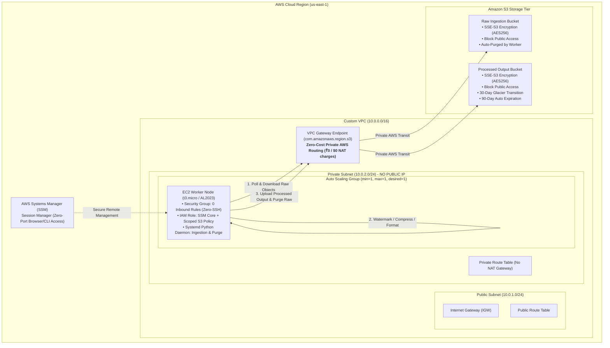

# Enterprise Automated Private Image/Document Processor

[](https://www.terraform.io/)
[](https://registry.terraform.io/providers/hashicorp/aws/latest)
[-success)](#-100-free-tier-compliance-matrix)
[-blue)](#3-security-groups--zero-ssh-access)
[](https://www.python.org/)

An enterprise-grade, asynchronous, zero-trust cloud processing pipeline built on **Amazon Web Services (AWS)** using **Terraform (IaC)**. 

Engineered strictly to operate **100% within the AWS Free Tier**, eliminating costly infrastructure charges (like NAT Gateways) by leveraging **VPC Gateway Endpoints** and **AWS Systems Manager (SSM)**.

---

## 🏛️ System Architecture



---

## 💰 100% Free Tier Compliance Matrix

| AWS Service | What This Project Configures | Free Tier Allowance (12 Mo) | Project Consumption | Cost |
| :--- | :--- | :--- | :--- | :--- |
| **VPC & Subnets** | Custom VPC, Public Subnet, Isolated Private Subnet, Route Tables | Always Free | 1 VPC, 2 Subnets, 2 Route Tables | **₹0.00** |
| **VPC Gateway Endpoint** | S3 Gateway Endpoint (`com.amazonaws.<region>.s3`) | Always Free (replaces ₹2,600/mo NAT Gateway) | 1 Gateway Endpoint | **₹0.00** |
| **EC2 Worker Node** | 1x `t3.micro` inside Auto Scaling Group | 750 hrs / month | ~720 hrs / month (100% covered) | **₹0.00** |
| **EBS Storage** | Root Volume (`gp3`, encrypted) | 30 GB / month | 8 GB total | **₹0.00** |
| **Auto Scaling Group** | `min=1, max=1, desired=1` (Auto-Healing) | Always Free | 1 ASG | **₹0.00** |
| **Security Groups** | Stateful firewall (**0 Inbound Rules, Zero SSH**) | Always Free | 1 Security Group | **₹0.00** |
| **IAM & SSM** | Role, SSM Core Policy, Scoped S3 Policy | Always Free | 1 Role & Instance Profile | **₹0.00** |
| **Amazon S3** | 2 Buckets (Raw + Processed) + SSE-S3 + Glacier Lifecycle | 5 GB Standard, 20k GET, 2k PUT | < 100 MB testing data | **₹0.00** |

---

## 🚀 Key Architectural Pillars

### 1. Modular & Multi-Environment Terraform
Structured with clean, isolated Terraform Modules following production industry standards:
* `modules/network`: VPC, Public Subnet, Isolated Private Subnet, Internet Gateway, Route Tables, and S3 Gateway Endpoint.
* `modules/storage`: Dual S3 buckets with SSE-S3 AES-256 encryption, Public Access Block, and S3 Glacier lifecycle transitions.
* `modules/compute`: Least-privilege IAM roles, zero-inbound security groups, Launch Template, and Auto Scaling Group.
* Multi-environment workspace configuration ready via `environments/dev.tfvars` and `environments/prod.tfvars`.

### 2. Private Subnet Isolation & The S3 Gateway Endpoint Twist
* The EC2 worker node operates in a strictly isolated **Private Subnet** with **no public IPv4 address**.
* Instead of deploying an expensive AWS NAT Gateway (~$32+/month), all storage traffic is routed through an **AWS S3 VPC Gateway Endpoint**. Traffic never traverses the public internet, maximizing security posture while reducing operating costs to **₹0**.

### 3. Zero-SSH Security Model
* EC2 Security Group contains **0 inbound rules**. Port 22 (SSH) is completely shut down.
* Management access is provisioned via an IAM role with `AmazonSSMManagedInstanceCore`. Developers and sysadmins connect via **AWS Systems Manager (SSM) Session Manager** directly from browser or AWS CLI without managing `.pem` private keys or opening bastion hosts.

### 4. Auto-Healing Worker Node
* Wrapped in an **Auto Scaling Group** (`min=1, max=1, desired=1`).
* Cloud-init launches a Python worker daemon as a resilient `systemd` service (`image-processor.service`) with auto-restart on failure.
* **The Demo Flex:** Terminating the EC2 instance manually in the AWS Console triggers Auto Scaling to detect the failure, launch a replacement instance, boot cloud-init, and resume processing within **50–60 seconds**.

### 5. Automated Asynchronous Processing & Queue Hygiene
* Continuous polling loop scans the **Raw Ingestion S3 Bucket**.
* **Documents (`.txt`, `.log`, `.md`, `.json`, `.csv`):** Prepends enterprise audit header with UTC timestamps and node metadata.
* **Images (`.png`, `.jpg`, `.jpeg`, `.webp`):** Optimizes quality, compresses size, and applies watermark banner.
* Processed outputs are uploaded to the **Processed S3 Bucket** under structured paths (`documents/`, `images/`).
* Raw objects are immediately purged from the ingestion bucket to maintain **zero queue backlog**.

---

## 📁 Repository Directory Structure

```text
├── README.md                    # Comprehensive documentation
├── versions.tf                  # Provider versions and Terraform constraints
├── variables.tf                 # Root variable declarations
├── terraform.tfvars.example     # Sample configuration parameters
├── main.tf                      # Root orchestration connecting modules
├── outputs.tf                   # Live resource outputs and CLI test commands
├── deploy.sh                    # Automated deployment management script
├── test_pipeline.sh             # Live end-to-end integration test runner
├── environments/
│   ├── dev.tfvars               # Dev workspace CIDR (10.10.0.0/16)
│   └── prod.tfvars              # Prod workspace CIDR (10.20.0.0/16)
├── modules/
│   ├── network/                 # VPC, IGW, Subnets, S3 Gateway Endpoint
│   ├── storage/                 # Dual S3 Buckets, SSE-S3, Glacier Lifecycle
│   └── compute/                 # Zero-SSH SG, SSM IAM Role, LT, ASG
├── worker_app/
│   └── processor.py             # Resilient Python worker daemon
└── test_assets/
    ├── sample.txt               # Sample document for verification
    └── sample.png               # Sample image for verification
```

---

## 🛠️ Quickstart Deployment

### 1. Configure AWS Credentials
Ensure your terminal has AWS access:
```bash
export AWS_ACCESS_KEY_ID="<your-access-key>"
export AWS_SECRET_ACCESS_KEY="<your-secret-key>"
export AWS_DEFAULT_REGION="us-east-1"
```

### 2. Deploy with One Command
```bash
chmod +x deploy.sh test_pipeline.sh
./deploy.sh apply
```

### 3. Run Live Verification
```bash
./test_pipeline.sh
```

### 4. Clean Up
To destroy all provisioned resources anytime:
```bash
./deploy.sh destroy
```

---

## 🎯 Interview Talking Points ("The Demo Flex")

1. **Auto-Healing Demonstration:**  
   In the AWS EC2 Console, manually click **Terminate Instance** on the running worker. Show the interviewer that within ~50 seconds, the Auto Scaling Group detects capacity loss, bootstraps a replacement instance via the Launch Template, and resumes processing automatically.
2. **Zero-Trust Security:**  
   Show the Security Group with **0 inbound rules** and the EC2 instance with **no public IPv4**. Connect via browser through **AWS Systems Manager (SSM) Session Manager** with zero firewall holes.
3. **Enterprise Cost Optimization:**  
   Explain how the **VPC Gateway Endpoint for S3** eliminates NAT Gateway charges (~$32/mo), keeping data transfers internal and 100% Free Tier.

---

## 📄 License
This project is open-source and licensed under the [MIT License](LICENSE).
